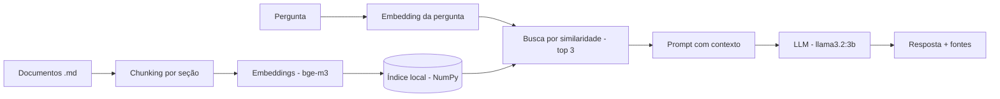

# Chatbot RAG — NovaLar Móveis (empresa fictícia)

Chatbot de atendimento que responde dúvidas de clientes **somente com base em documentos da empresa**, usando a técnica RAG (Retrieval-Augmented Generation). Roda **100% local e gratuito**, sem APIs pagas e sem custo por uso.

## Como funciona



1. **Ingestão (`ingest.py`)**: lê os documentos, divide em pedaços por seção e gera um vetor (embedding) para cada um.
2. **Busca (`rag.py`)**: transforma a pergunta em vetor e recupera os 3 pedaços mais parecidos (similaridade de cosseno).
3. **Geração (`rag.py`)**: envia os trechos ao LLM com a instrução de responder apenas com base no contexto e de recusar quando a informação não existir.
4. **Interface (`app.py`)**: chat em Streamlit, com os trechos usados disponíveis em "Ver fontes".

## Tecnologias

| Camada | Ferramenta |
|---|---|
| LLM | Ollama + `llama3.2:3b` |
| Embeddings | Ollama + `bge-m3` (multilíngue) |
| Busca vetorial | NumPy (similaridade de cosseno) |
| Interface | Streamlit |
| Linguagem | Python |

## Como rodar

Pré-requisitos: [Ollama](https://ollama.com) instalado e Python 3.10+.

```bash
# 1. Baixar os modelos
ollama pull llama3.2:3b
ollama pull bge-m3

# 2. Em um terminal, deixar o servidor rodando
ollama serve

# 3. Em outro terminal, preparar o ambiente
python -m venv venv
source venv/bin/activate
pip install -r requirements.txt

# 4. Gerar o índice e abrir o chat
python ingest.py
streamlit run app.py
```

## Avaliação

O script `eval.py` faz 17 perguntas automáticas: 14 com resposta nos documentos e 3 fora do escopo (o bot deve recusar).

**Resultado: 16/17.** Todas as 3 perguntas fora do escopo foram recusadas corretamente.

**Falha conhecida:** na pergunta "Em quantas vezes posso parcelar uma compra de R$ 600?", a busca recuperou o trecho correto, mas o modelo de 3B parâmetros errou a comparação numérica (tratou R$ 600 como abaixo de R$ 500). É uma limitação de raciocínio de modelos pequenos, não de recuperação.

## Decisões de projeto e limitações

- **Busca em NumPy em vez de banco vetorial:** o ChromaDB não instalou no ambiente de desenvolvimento (macOS antigo, sem pacotes compatíveis). Para uma base pequena, a busca por similaridade em NumPy é simples e suficiente. Em escala maior, a troca natural seria por um banco vetorial como ChromaDB ou FAISS.
- **Modelo pequeno por restrição de hardware:** desenvolvido em um Mac com 8 GB de RAM, sem GPU.
- **Mitigação possível para a falha numérica:** usar um modelo maior ou tratar regras numéricas fora do LLM.

## Estrutura

```
chatbot-rag/
├── data/            # documentos da empresa fictícia
├── ingest.py        # chunking + embeddings
├── rag.py           # busca + geração
├── app.py           # interface Streamlit
├── eval.py          # avaliação automática
└── requirements.txt
```